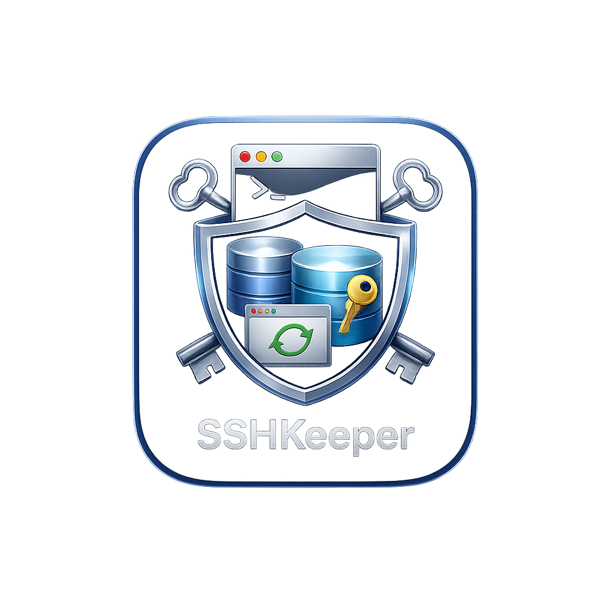

# SSHKeeper



面向 macOS 的 SSH 主机管理、数据库和网页面板工作台，使用 Swift、SwiftUI 和 AppKit 开发。

## 功能

- **SSH 主机管理** — 导入 `~/.ssh/config`，管理分组、标签、私钥和多标签终端会话。
- **文件上传** — 拖拽文件到终端，或通过菜单选择文件，使用 SCP 上传文件及目录，查看进度、取消与重试。
- **数据库工作台** — 支持 MySQL 和 PostgreSQL，提供 SQL 编辑、结果表格、行内编辑、表结构和索引管理、CSV 导出。
- **SSH 隧道** — 通过已有 SSH 主机配置访问数据库。
- **网页面板** — 在应用内打开宝塔、1Panel 等后台页面，自动填写登录表单，多标签切换。
- **凭据管理** — SSH、数据库和面板密码存储在 macOS Keychain。

## 下载安装

前往 [GitHub Releases](https://github.com/glassBoul/SSHKeeper/releases/latest)，下载 `SSHKeeper-1.0.0-universal.dmg`，打开后将 `SSHKeeper.app` 拖入「应用程序」。

安装包支持 macOS 14 及以上，包含 Apple Silicon 和 Intel 架构，已通过 Developer ID 签名和 Apple 公证。发布页同时提供 `SHA256SUMS` 校验文件。

## 环境要求

- macOS 14 Sonoma 或更高版本。
- 支持 Swift 6 的 Xcode，安装并完成首次启动配置。
- Xcode 的 Metal Toolchain 组件，SwiftTerm 构建终端渲染资源时需要。可在 Xcode 的 Settings → Components 中安装，或运行 `xcodebuild -downloadComponent MetalToolchain`。
- [XcodeGen](https://github.com/yonaskolb/XcodeGen)，用于从 `project.yml` 生成工程。

安装 XcodeGen 后获取源码并生成工程。

```bash
brew install xcodegen
git clone https://github.com/glassBoul/SSHKeeper.git
cd SSHKeeper
xcodegen generate
```

Swift Package Manager 会在首次构建时下载依赖，需要网络连接。
仓库保留 `SSHKeeper.xcodeproj/project.xcworkspace/xcshareddata/swiftpm/Package.resolved`，记录项目现有依赖版本；其余工程文件由 XcodeGen 生成。

## 本地构建

项目的签名默认用于维护者的 Developer ID 发布流程。以下命令使用本机架构和 ad hoc 签名，适合从源码编译运行。

```bash
xcodebuild build \
  -project SSHKeeper.xcodeproj \
  -scheme SSHKeeper \
  -configuration Debug \
  -destination 'platform=macOS' \
  -derivedDataPath build/local \
  -onlyUsePackageVersionsFromResolvedFile \
  ARCHS="$(uname -m)" \
  ONLY_ACTIVE_ARCH=YES \
  CODE_SIGN_IDENTITY=- \
  DEVELOPMENT_TEAM= \
  OTHER_CODE_SIGN_FLAGS=

open build/local/Build/Products/Debug/SSHKeeper.app
```

也可以在 Xcode 中打开生成的 `SSHKeeper.xcodeproj`，选择 `SSHKeeper` scheme，并将 Debug 签名设置为本机可用的签名方式。更换签名后，Keychain 可能要求重新授权读取已保存的密码。

## 运行测试

```bash
xcodebuild test \
  -project SSHKeeper.xcodeproj \
  -scheme SSHKeeper \
  -configuration Debug \
  -destination 'platform=macOS' \
  -derivedDataPath build/local \
  -onlyUsePackageVersionsFromResolvedFile \
  ARCHS="$(uname -m)" \
  ONLY_ACTIVE_ARCH=YES \
  CODE_SIGN_IDENTITY=- \
  DEVELOPMENT_TEAM= \
  OTHER_CODE_SIGN_FLAGS=
```

现有测试覆盖 SSH 配置解析、配置写入、元数据存储、SQL 生成、CSV 导出与版本比较等逻辑。

## 配置和数据

| 内容 | 位置 |
| --- | --- |
| 导入的 SSH 配置 | `~/.ssh/config` 及其 Include 文件 |
| 应用管理的 SSH 配置 | `~/.ssh/config.d/sshkeeper.conf` |
| 分组、面板及数据库连接信息 | `~/Library/Application Support/SSHKeeper/metadata.json` |
| 登录密码 | macOS Keychain |

首次接入 SSH 配置时，应用会请求添加 Include 指令，并备份原配置。SSH 配置中的 `Match` 条件块暂不导入，应用会提示跳过的数量。

面板自动填写取决于网页表单结构，验证码和多因素认证需要手动完成。当前面板 WebView 会接受自签 HTTPS 证书。

应用启动后会访问 `https://sshkeeper.feilian.cc/version.json` 检查更新。自行分发时，可在 `SSHKeeperCore/Features/Updates/UpdateConfig.swift` 中设置自己的更新地址。

## 打包与公证

分发经过 Developer ID 签名和 Apple 公证的版本，需要自己的 Apple Developer 账号和证书。

```bash
cp .env.example .env
```

将 `.env` 中的 `DEVELOPMENT_TEAM` 替换为自己的 Team ID。使用 `xcrun notarytool store-credentials` 将公证凭据保存至 Keychain，并将对应 profile 名称写入 `NOTARY_PROFILE`。

```bash
bash Tools/build_release.sh
bash Tools/notarize.sh build/SSHKeeper.dmg
```

构建脚本生成包含 Apple Silicon 和 Intel 架构的 DMG。`web/` 提供产品介绍页和更新清单，分发时需要同步实际版本号、下载文件名及 SHA256。

## 项目结构

```text
SSHKeeper/       SwiftUI 和 AppKit 应用界面
SSHKeeperCore/   SSH 配置、密钥、数据库及持久化逻辑
SSHKeeperTests/  XCTest 测试与示例配置
Tools/          Release 打包和公证脚本
web/            静态产品介绍页及更新清单
docs/           功能设计和实现记录
project.yml     XcodeGen 工程定义
```

## 依赖

- [SwiftTerm](https://github.com/migueldeicaza/SwiftTerm) 提供终端组件。
- [PostgresNIO](https://github.com/vapor/postgres-nio) 提供 PostgreSQL 连接。
- [MySQLNIO](https://github.com/vapor/mysql-nio) 提供 MySQL 连接。

依赖的许可证见各自仓库。

## 参与贡献

欢迎通过 Issues 反馈问题或提出建议，也欢迎提交 Pull Request。报告问题时请附上 macOS 版本、复现步骤和相关日志，并隐藏密码、私钥和服务器地址等敏感信息。

## 许可证

本项目使用 [MIT License](LICENSE)。
